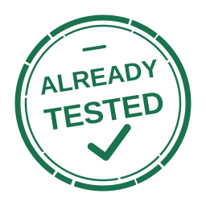

# already-tested

[](https://github.com/dblock/already-tested/actions/workflows/test.yml) [](https://github.com/dblock/already-tested/actions/workflows/lint.yml) [](https://github.com/dblock/already-tested/actions/workflows/package.yml)

Skip duplicate CI tests when a trusted local run matches the committed source and workflow. **Claims are not proof that tests ran.**

Use your project's existing checks, in any language.

## Install

Git 2.29+ is required. Until standalone distribution is available, install the unreleased CLI from source using Node.js 24.x or 26+ and npm:

```sh
git clone https://github.com/dblock/already-tested.git ../already-tested
npm install --global --ignore-scripts ../already-tested
```

This installs `already-tested` on your PATH, outside your project's dependencies. Node/npm are current installation details; the command stays the same with a future binary.

## Configure CI

Add the gate before setup and tests in `.github/workflows/test.yml`. Here `./script/ci` stands for your project's existing CI command:

```yaml
name: Test
on:
  push:
  pull_request:
    types: [opened, synchronize, reopened, edited]
permissions:
  contents: read
jobs:
  test:
    runs-on: ubuntu-latest
    steps:
      - uses: actions/checkout@v7.0.1
        with:
          fetch-depth: 2
          persist-credentials: false
      - uses: dblock/already-tested@master
        id: tested
        with:
          check: test-linux
      - if: steps.tested.outputs.skip != 'true'
        run: ./script/ci
```

Apply the same condition to your language's setup/install steps. The Action's runtime is provided by GitHub; it needs no `setup-node` step. Use a distinct `check` per job or matrix environment and pin a reviewed Action commit for production.

Missing, stale, or invalid claims run CI normally; pushes always run CI. A match skips the conditioned steps, not the workflow or its required check.

## Claim a Local Run

For the example above, use the matching Linux environment and replace the environment placeholder with the toolchain versions and OS you actually validated:

1. Run `./script/ci`.
2. Commit the tested source without further edits.
3. Generate the claim:

```sh
already-tested claim --workflow .github/workflows/test.yml --check test-linux \
  --command './script/ci' --environment '<actual toolchain versions and OS>'
```

Paste the **entire output** into the PR description. It shows expandable validation details and hides the machine-readable claim. Regenerate after source or workflow changes. The CLI records your command and environment; it does not run or verify them.

For agents, add to your project's `AGENTS.md`:

```markdown
Run CI checks locally in their matching environments, commit the tested source, then generate claims with `already-tested claim --workflow <workflow> --check <check> --command '<actual command>' --environment '<actual toolchain versions and OS>'`. Paste the complete output into the PR description. Regenerate after changes; never claim checks or environments you did not validate.
```

By default, claims cover all tracked files plus the workflow. Anyone who can edit the PR description can forge a claim. Untracked files, external state, and environment differences are not verified; keep independent checks where needed.

## Reference

[Options, file filters, API, and limitations](DESIGN.md) | [Contributing](CONTRIBUTING.md) | [Changelog](CHANGELOG.md) | [Releasing](RELEASING.md) | [MIT License](LICENSE)
