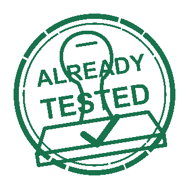

<picture>
  <source media="(prefers-reduced-motion: reduce)" srcset="assets/logo.svg">
  
</picture>

# already-tested

[](https://github.com/dblock/already-tested/actions/workflows/test.yml) [](https://github.com/dblock/already-tested/actions/workflows/lint.yml) [](https://github.com/dblock/already-tested/actions/workflows/package.yml)

Skip duplicate CI tests using trusted, content-matched claims in pull request descriptions.

Agents run tests locally and paste a generated claim into the PR description. The Action compares committed file content and the workflow, then tells existing CI whether to skip duplicate tests. **Claims are trusted statements, not proof that tests ran.**

## Installation

Not published to npm yet. Install a local checkout in the project being tested:

```sh
npm install --save-dev /path/to/already-tested
```

Requires Git 2.29 or later and Node.js 24 or 26 or later. The Action uses GitHub's Node.js 24 runtime. Use `dblock/already-tested@master` to try the unreleased Action after merge; pin a reviewed commit for production use.

## Usage

Run the relevant tests, commit exactly that tested source without further changes, then generate a claim:

```sh
npx already-tested claim --workflow .github/workflows/test.yml --check unit \
  --command 'npm test' --environment 'Node.js 26 on macOS'
```

Use your actual tested command and environment. Paste the entire generated section into the PR description: a compact expandable check with bulleted validation details, a visible content SHA-256, and the machine-readable claim hidden inline. Add this gate to the existing workflow; PR-description edits must trigger it too:

```yaml
name: Test
on:
  push:
  pull_request:
    types: [opened, synchronize, reopened, edited]
permissions:
  contents: read
jobs:
  test:
    name: Test
    runs-on: ubuntu-latest
    steps:
      - name: Check Out Source
        uses: actions/checkout@v7.0.1
        with:
          fetch-depth: 2
          persist-credentials: false
      - name: Check Local Test Claim
        uses: dblock/already-tested@master
        id: tested
        with:
          check: unit
      - name: Run Tests
        if: steps.tested.outputs.skip != 'true'
        run: |
          npm ci
          npm test
```

`fetch-depth: 2` makes the PR head and executing workflow available with GitHub's default merge checkout. A missing object, missing/malformed/stale claim, unsupported input, or non-PR event produces `skip=false`. Setup/install steps can use the same condition. The workflow still runs and produces its normal required check.

Add instructions to the consuming project's `AGENTS.md`:

```markdown
## Local CI Claims

Run the workflow's tests locally after the last source change. Commit all tested source without further edits, then run `npx already-tested claim --workflow .github/workflows/test.yml --check unit --command 'npm test' --environment '<actual Node version and OS>'`. Use the actual command and environment you validated. Paste the complete default expandable section into the PR description; concatenate checks without blank separators or outer bullets. Keep the canonical claim hidden inline, not in a code block. Regenerate after source or workflow changes. Never claim a different job or matrix environment passed.
```

## Configuration

The required `check` identifier must match the CLI and distinguish jobs/matrix environments. `files` optionally narrows tracked files using newline-separated Git pathspecs; repeat `--files` on the CLI with the same patterns. Both sides default to all tracked files and always include the executing workflow. See [Design](DESIGN.md) for examples, the claim format, CLI/API details, and limits.

`--summary` sets the expandable label, defaulting to `<check> - passed`. Optional `--command` and `--environment` describe what you actually validated; omitted fields stay omitted. These values are recorded, not executed or verified. `--raw` produces the original single hidden comment for machine consumers and cannot be combined with display metadata.

Anyone able to edit the PR description can forge a claim. This does not validate the test command, dependencies, external state, or environment. Keep independent integration/platform/merge checks where needed. Symlinks and submodules are unsupported when selected, and ignored/untracked files are not hashed.

## Contributing

Read [Contributing](CONTRIBUTING.md), [Design](DESIGN.md), [Changelog](CHANGELOG.md), [Releasing](RELEASING.md), and [Agent Instructions](AGENTS.md).

## License

[MIT](LICENSE).
